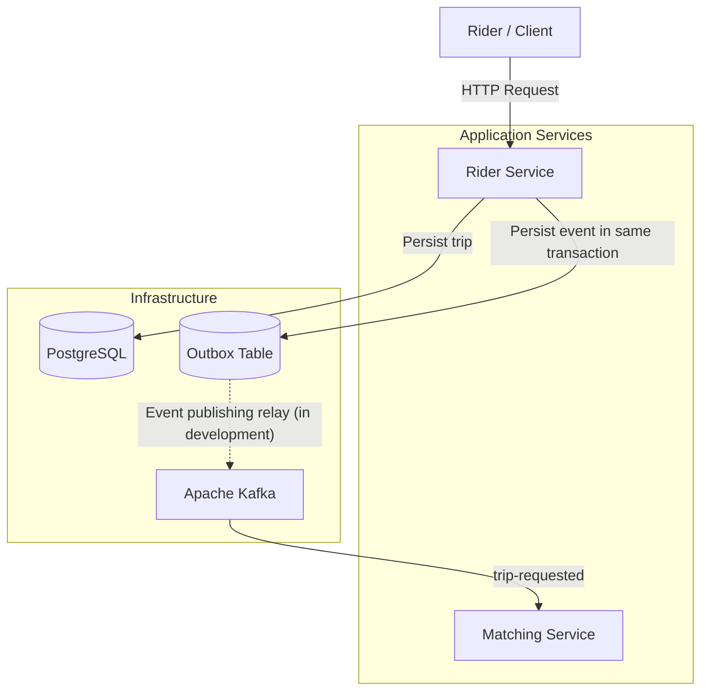

# Plume — Event-Driven Ride-Hailing Backend

Plume is a ride-hailing backend built with Java and Spring Boot, exploring microservices architecture, event-driven communication, and distributed systems concepts.

The project models the core ride-request workflow: a rider requests a trip, the system identifies a suitable nearby driver, and the trip progresses through its lifecycle.

Rather than building this as a single monolithic application, Plume is being developed as a collection of independently deployable services that communicate asynchronously through Apache Kafka.

> **Project status:** In active development. Core trip management and initial inter-service event communication are implemented. Driver matching and the broader ride-hailing workflow are being developed incrementally.

---

## Architecture

Plume currently consists of two services:

- **Rider Service:** Responsible for trip management, including creating and persisting trip requests.
- **Matching Service:** Consumes trip-request events and serves as the foundation for driver discovery and assignment.

Services communicate through Kafka rather than making synchronous HTTP calls to one another.

### High-level architecture



*The diagram represents the intended outbox-based event flow. The outbox persistence mechanism is implemented; its publishing relay is still being developed.*

---

## Engineering Highlights

### 1. Microservices Architecture

The application separates responsibilities into independently deployable Spring Boot services.

- **Service boundaries:** Trip management and driver matching are separated into distinct services.
- **Independent persistence:** The Rider Service owns its trip data, while other services consume events rather than directly accessing its database.
- **Asynchronous communication:** Apache Kafka provides the communication layer between services, reducing direct runtime dependencies.

### 2. Event-Driven Communication with Apache Kafka

Kafka is used to facilitate asynchronous communication between services.

- Implemented event production in the Rider Service for trip requests.
- Implemented event consumption in the Matching Service using Kafka consumers.
- Configured JSON serialization and deserialization for event payloads.
- Configured Kafka consumer groups to support independent event consumption and offset management.

The initial integration uses a `trip-requested` event to communicate the creation of a new trip to the Matching Service.

### 3. Transactional Outbox Pattern

To address the dual-write problem associated with persisting application data and publishing events, Plume uses the transactional outbox pattern.

When a trip is created, the trip record and its corresponding event are persisted within the same database transaction.

This ensures that either both records are committed or neither is, preventing inconsistencies where a trip is successfully persisted but its corresponding event is lost.

The outbox persistence mechanism is implemented. The event publishing relay is currently under development.

### 4. Containerized Infrastructure

Docker Compose is used to manage the local development infrastructure, including PostgreSQL, Apache Kafka, and Redis.

This provides a reproducible environment for developing and testing the services without requiring separate manual installations of these dependencies.

---

## Technology Stack

| Category | Technologies |
|---|---|
| Language | Java |
| Framework | Spring Boot |
| Database | PostgreSQL |
| Messaging | Apache Kafka |
| Caching | Redis (infrastructure provisioned; integration pending) |
| Containerization | Docker, Docker Compose |
| Build Tool | Maven |
| Testing | JUnit 5 |

---

## Project Structure

```text
plume/
├── rider-service/
│   └── src/
│       ├── main/
│       └── test/
│
├── matching-service/
│   └── src/
│       ├── main/
│       └── test/
│
├── compose.yaml
└── README.md
```

Each service is maintained as an independent Spring Boot application with its own dependencies, configuration, and tests.

---

## Getting Started

### Prerequisites

- Java (version compatible with the service build configuration)
- Docker Engine
- Docker Compose
- Git

### 1. Clone the repository

```bash
git clone https://github.com/ktnbuilds/plume.git
cd plume
```

### 2. Configure environment variables

The Rider Service uses environment variables for its database connection:

```env
DB_URL=jdbc:postgresql://localhost:5433/rider_db
DB_USER=rider_user
DB_PASSWORD=your_database_password
```

Configure the corresponding variables in your local environment before starting the service.

The Docker Compose configuration also expects `POSTGRES_PASSWORD` when starting PostgreSQL.

### 3. Start the infrastructure

```bash
docker compose up -d
```

This starts the infrastructure services defined in `compose.yaml`.

### 4. Run the application services

Start each Spring Boot service independently from its respective directory.

For example:

```bash
cd rider-service
./mvnw spring-boot:run
```

In another terminal:

```bash
cd matching-service
./mvnw spring-boot:run
```

---

## Development Roadmap

Plume is being developed incrementally, with the following areas forming the broader development roadmap:

- [x] Initial Rider Service implementation with PostgreSQL persistence.
- [x] Initial Matching Service setup.
- [x] Kafka producer and consumer integration.
- [x] Trip-request event serialization and deserialization.
- [x] Transactional outbox table and atomic event persistence.
- [ ] Outbox event publishing relay.
- [ ] Reliable event delivery, failure handling, and consumer idempotency.
- [ ] Driver Service for driver registration, profiles, availability, and location updates.
- [ ] Nearby driver discovery and trip assignment.
- [ ] Driver reservation and concurrency handling.
- [ ] Redis integration for geospatial driver discovery and availability.
- [ ] Authentication and authorization.
- [ ] Notification service and broader trip lifecycle management.
- [ ] Comprehensive integration and end-to-end testing.

---

## Motivation

Plume is a personal backend engineering project focused on understanding the challenges that arise when moving beyond a traditional monolithic application.

Through its development, I'm exploring distributed systems concepts such as asynchronous communication, data consistency across service boundaries, event delivery guarantees, concurrency, and service ownership.

The goal is to build a working ride-hailing backend while developing a deeper understanding of the engineering decisions involved in designing and implementing distributed applications.
